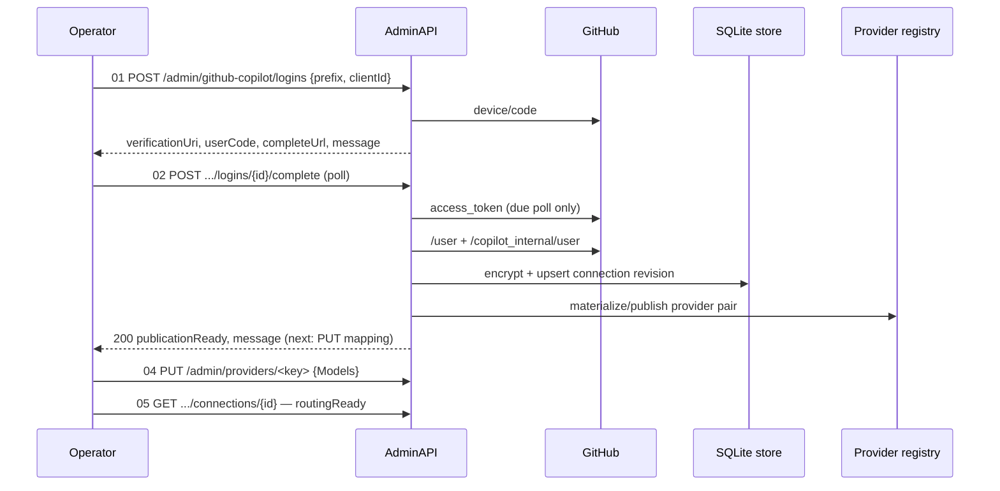

# GitHub Copilot Providers — High-Level Design

| | |
|---|---|
| **Status** | Completed — opt-in `github-anthropic` / `github-openai` provider pairs, device login, local SQLite credentials and managed routing are live. LADR-01..04 + NFR-01/02 Accepted. Live own-app verification is a release gate, not a design gate. |
| **Owner** | SmoothLlmImposter maintainers |
| **Tracker** | [Feature #126](https://github.com/generic-automation-and-it/smooth-llm-imposter/issues/126) |
| **Last updated** | 2026-10-20 |

> Design HLD. This document delivers **intent + spec** — what is built and why, the decisions behind it, and
> the quality bar it must meet. It does not contain an implementation plan.

## TL;DR

An opt-in feature flag (`ENABLE_GITHUB_COPILOT`) adds GitHub Copilot as an upstream without a database server.
One GitHub device login connects a **protocol pair** — `github-anthropic` + `github-openai`, or a named
`<prefix>-github-anthropic` / `<prefix>-github-openai`. Anthropic callers reach `/v1/messages`, OpenAI/GPT
callers reach `/responses`; no OpenAI⇄Anthropic or Chat translation is added. Credentials are stored encrypted
in a local SQLite file inside a dedicated Docker volume, hydrated into an immutable in-memory snapshot at
startup, and never read on the inference path.

## Intent

The router's value is routing existing agent traffic to whichever upstream an operator chooses, and GitHub
Copilot is a first-class upstream for Claude Code and Codex sessions. Two properties make it different from
every other provider:

- **No config-only credential.** A Copilot token is obtained through a browser device grant and expires or is
  revoked server-side. Asking an operator to paste it into `Secret` would be a manual, silent-expiry workflow.
- **Account-scoped API.** The upstream origin, model catalog and entitlement are per account and discovered at
  login, so neither the origin nor the model list can be shipped in configuration.

The design therefore adds the smallest durable thing that solves both: a per-prefix connection row, encrypted,
behind the existing routing credential seam. It does **not** become a credential vault, a distributed store or a
routing-config persistence layer — HLD 008's registry stays ephemeral.

## Key Goals

### 1. Reserved, feature-owned identities (R1/D1)

`github-anthropic`, `github-openai`, `<prefix>-github-anthropic`, `<prefix>-github-openai` are recognized by an
**exact terminal suffix** in Domain. The prefix is the account identity: one login supplies both keys of its
prefix; different prefixes cannot share a token. Generic `/admin/providers` CRUD may edit `Models` and `Enabled`
but cannot create the keys, change dialect/auth identity or delete one whose prefix still has a saved connection.

### 2. Ordered, self-service device login (R3/R10)

Five numbered steps: start login → complete login → discover models → configure mappings → verify. Every admin
response carries a plain `message` field naming the next curl step, so the workflow works without Scalar. The
effective OAuth client ID resolves **explicit request `clientId` > the prefix's saved client ID > optional
`GITHUB_COPILOT_CLIENT_ID`**; a supplied-but-malformed value is a 400, never a fallback. The client ID is frozen
into the pending flow and saved atomically with the credential revision, so a config change can never rebind an
old token to a new OAuth app.

### 3. Durable, encrypted, local (R5/R7/R9)

`Microsoft.Data.Sqlite` directly — parameterized ADO.NET, explicit row mapping, no ORM and no reflection — in a
feature-owned store. Tokens are Data-Protected with an **isolated key ring** under the same dedicated volume
(`/data/github-copilot/keys`), so enabling the feature can never invalidate the generic credential key ring.
Disabling the feature does not delete data; credential removal is volume-level only in v1 (D3).

### 4. Managed routing at the existing seam (R2/R4)

A matched imposter route whose provider key is a reserved profile resolves its token and effective base URL from
the immutable published snapshot, then hands a `RouteCredentialOverride` to the existing forwarder. Only the
same-dialect completion paths are forwarded (`/v1/messages`, `/responses`); Copilot Chat/other paths are refused
before the token is attached. The discovered origin is validated (HTTPS, default port, GitHub-controlled host)
and redirects are never followed. Missing, expired or revoked credentials fail closed — caller auth is never
borrowed.

### 5. Saved versus published (D2)

SQLite commit and in-memory publication are not one transaction. Complete retries publication a bounded number
of times from the already-saved revision and returns 200 only once the pair is published; retry exhaustion
returns 503 with the saved revision and a restart hint. Startup seeds config → hydrates connections →
re-materializes missing pairs before serving. There is no reconcile endpoint and no publication worker.

### 6. Token lifecycle (R8/R9)

Expiring tokens carry an optional refresh token. A feature-scoped refresher rotates the pair ahead of expiry,
saves it atomically, then publishes; a terminal refresh failure, expiry or save failure marks the connection
reauthentication-required (fail closed) while retaining the row. An upstream 401 invalidates only the revision
that request was planned against; a 403 model-policy response does not revoke the account.

## Workflow

## Decisions

| LADR | Decision |
|---|---|
| [LADR-001](./ladrs/LADR-001-reserved-provider-identity.md) | Reserved provider identity is feature-owned; Models/Enabled stay editable |
| [LADR-002](./ladrs/LADR-002-saved-vs-published-recovery.md) | Accept the saved-but-unpublished window; bounded retry + restart re-materialization |
| [LADR-003](./ladrs/LADR-003-volume-only-removal.md) | Credential removal is exact dedicated-volume removal only in v1 |
| [LADR-004](./ladrs/LADR-004-direct-microsoft-data-sqlite.md) | Persistence is direct Microsoft.Data.Sqlite, not Dapper or an ORM |

| NFR | Requirement |
|---|---|
| [NFR-001](./nfrs/NFR-001-credential-confidentiality.md) | No plaintext token in store, response, query string or log; documented threat boundary |
| [NFR-002](./nfrs/NFR-002-fail-closed-availability.md) | Fail closed on unusable credentials; corrupt storage is actionable, never reset |

## Scope and limits

- **In:** reserved profile parsing, device login, local encrypted SQLite, startup hydration, refresh, admin
  APIs, Scalar/OpenAPI, managed routing/transport policy, Docker volume recipe, tests/docs/architecture
  amendments.
- **Out:** Copilot Chat support, OpenAI⇄Anthropic body translation, a generic credential-store replacement,
  PostgreSQL, whole-registry persistence, distributed/multi-replica volume sharing, an external vault, a
  broker/queue, in-app connection removal/revocation, and an admin reconcile endpoint.
- One application instance per local data volume. GitHub-side OAuth revocation remains a manual operator action.
- The three account probes recorded during design are evidence for those account/model combinations only;
  verifying an own registered OAuth application end-to-end (Messages, Responses, SSE, tools, real agent
  sessions) remains an external release gate.
