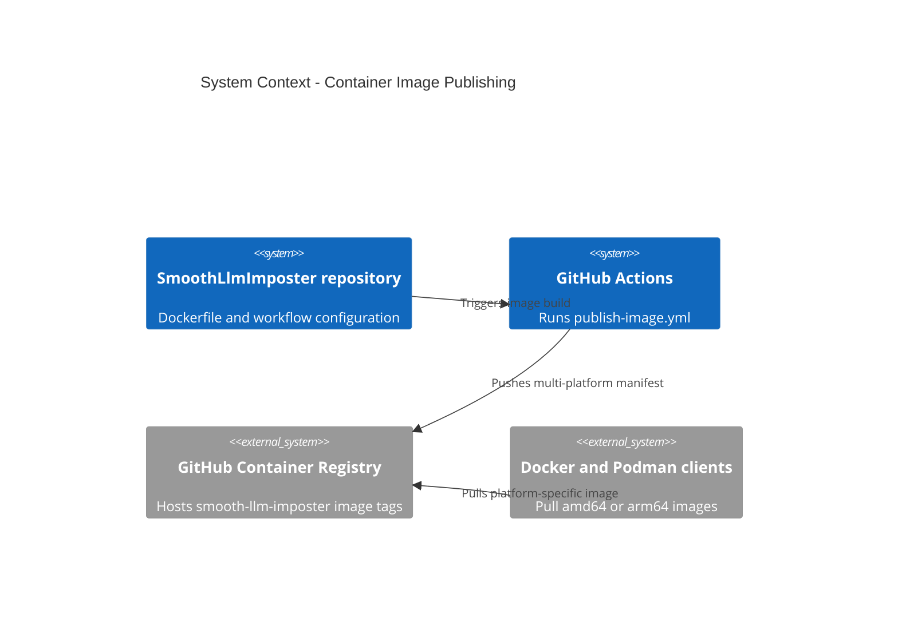

# GitHub Workflows Context

## TL;DR

GitHub workflow changes must preserve publishable CI behavior; container image tags must stay multi-architecture for both `linux/amd64` and `linux/arm64`. AI self-fix initialization must track the fetched review tooling's OpenCode setup contract.

## Non-Negotiables

- Do not remove QEMU from `publish-image.yml` while the Dockerfile runs `dotnet restore` or `dotnet publish` during target-platform builds.
- Do not narrow published GHCR tags to a single platform unless the setup docs and Docker/Podman guidance are updated in the same PR.
- Do not change the image owner/name away from `ghcr.io/generic-automation-and-it/smooth-llm-imposter` unless the repository remote or package ownership changes.
- Install OpenCode through the fetched `install-opencode.sh`, which honors `OPENCODE_CLI_VERSION`; do not duplicate an unversioned curl installer in the self-fix workflow.
- Source `prepare-opencode-config.sh` so `OPENCODE_CONFIG` reaches the current shell. Support the legacy `setup-opencode-config.sh` only when the new helper is absent.

## System Context

The workflow publisher turns the repo-root Dockerfile into the GHCR package used by Docker and Podman setup docs. GitHub Actions runs the build on an amd64 runner, Buildx creates the multi-platform manifest, and QEMU enables the arm64 build steps that execute inside the SDK image.

## Architecture Decisions

### LADR-001: Publish GHCR Tags as Multi-Platform Manifests

- **Date**: 2026-07-04
- **Status**: Accepted
- **Context**: GitHub's hosted Linux runner is amd64, so a default Buildx publish creates an amd64-only image. Apple Silicon Docker and Podman clients request `linux/arm64/v8` by default and fail when a tag lacks an arm64 manifest.
- **Decision**: `publish-image.yml` must set up QEMU before Buildx and publish at least `linux/amd64,linux/arm64` for GHCR tags.
- **Consequences**: Container publishes may take longer, but one `latest`, semver, or `sha-*` tag works across x64 Linux hosts and Apple Silicon machines.

## Key Behaviors

- `sha-*`, `latest`, and semver tags should point at a manifest list that includes both required platforms for the same workflow run.
- Existing GHCR tags published before the multi-platform workflow change may remain amd64-only unless they are republished.
- If .NET SDK or ASP.NET runtime base images change, verify their manifests still include every platform requested by `publish-image.yml`.
- The generous job `timeout-minutes` and the per-workflow/per-ref GHA cache `scope=` exist to keep the QEMU-emulated `arm64` `dotnet restore`/`publish` (~5–10× slower than native) inside a green build — do not tighten or remove them without re-measuring an emulated cold-cache run.
- The Dockerfile's BuildKit NuGet `--mount=type=cache,target=/root/.nuget/packages` only reuses packages **within a single build invocation** — the `type=gha` cache backend does not export `--mount=type=cache` contents, so there is no cross-run package reuse. Keep the mount (it is cheap and harmless), but do not add cross-run assumptions on top of it. Mount NuGet's global packages folder, not its scratch dir (`/tmp/NuGetScratch<user>` is user-suffixed and unused by `--no-restore` publish).
- **First-tag cold cache is intentional.** On the first build of a fresh `ref_name` (e.g. a new `v1.0.0` tag) `cache-from` has no matching scope entry, so Buildx cold-caches and starts exporting under the new scope on the next run. This is by design, not a config bug.
- The `pipeline-code-review-report.yml` thin caller keeps its reusable-workflow `uses:` ref and passed `tools_ref` aligned to upstream `main`; the self-fix tooling checkout also defaults to `main` (`SMOOTH_AI_REVIEW_TOOLS_REF` overrides that checkout). These moving refs require the copied self-fix setup to stay compatible with upstream helper changes.
- `pipeline-ai-analyse.yml` resolves review/analyse provider IDs in a separate step before initialization, using `GITHUB_ENV` to cross the shell boundary. After installation and config preparation, it optionally registers requested models, quarantines project config, stops the shared service, starts it via `stats`, and checks health. Health exit 3 (unconfirmed managed-config binding) aborts; other health failures and model-registration failures remain advisory, matching upstream.
- `OPENCODE_REVIEW_REPORT_CONFIG` forwards the optional repo-relative config override. If project config was quarantined, `Commit fixes` restores it before status/staging, including the no-edit path; never commit the managed stand-in. New registration/quarantine helpers are optional for older tooling checkouts.
- Automatic `workflow_run` jobs execute default-branch YAML independently of the checked-out PR/tooling version. Pushing a fix to a PR branch does not update that automatic path until merge.
- Run offline workflow regression checks with `python3 -m unittest discover -s .github/tests -v`; PR Gate runs them before .NET setup. Tests execute the actual inline shell blocks with temporary fixtures and stubbed tooling, covering version-pin forwarding, sourced config, provider/model ordering, legacy/optional helpers, failure handling, and pre-staging restoration. They never install OpenCode, call providers, restart a real service, or commit/push.

## Changelog

| Date | Change | Ref |
|:-----|:-------|:----|
| 2026-10-21 | Fixed self-fix initialization drift after run 39560285570 exited 127 calling the removed config installer. Synced setup with upstream `adf52980`: version-aware CLI install, sourced config with legacy fallback, provider/model registration ordering, project-config quarantine/restoration, and fail-closed service binding. Added 11 offline PR Gate regression tests; verified workflow YAML with actionlint, four deliberate regression mutations, and a smoke check using the real upstream installer/config/model/quarantine helpers with a stubbed CLI. | PR #130 |
| 2026-07-30 | [#95] Dockerfile base images switched from Debian to `-alpine` .NET 10 variants (`sdk:10.0-alpine`, `aspnet:10.0-alpine`). Verified multi-platform build still succeeds; image ~131 MB (was ~240 MB). Alpine ships busybox utilities including `wget`; `curl` is not in the base, so the Dockerfile's HEALTHCHECK comment was updated accordingly. (Verified via `docker run --rm mcr.microsoft.com/dotnet/aspnet:10.0-alpine sh -c 'which wget curl'`.) | |
| 2026-07-04 | Created workflow context for multi-architecture GHCR publishing (QEMU-before-Buildx, `setup-qemu-action` v4); recorded why the emulated-build job timeout, scoped GHA cache, and Dockerfile NuGet cache mount exist, and that first-tag cold cache is intentional. | #58 |
| 2026-07-25 | Added review-workflow caller pinning note: keep reusable `uses:` and `tools_ref` aligned to the same upstream SHA. | #78 |
