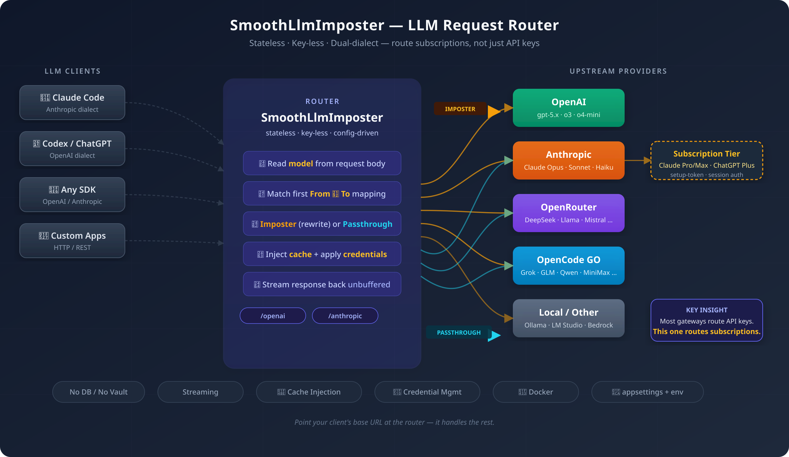

# SmoothLlmImposter

> A stateless, key-less LLM request router. Point your existing OpenAI- or Anthropic-dialect client at it,
> and it transparently redirects chosen models to alternate, cheaper, or local upstreams — rewriting the
> model name and optionally adding prompt caching — or passes the call straight through.

---

## TL;DR

SmoothLlmImposter sits between your LLM client (Claude Code, Codex, any OpenAI/Anthropic SDK) and the real
providers. For each request it reads the `model` and — per your `Imposter` config — either **imposters** it
(rewrites the model to a different upstream, optionally injecting prompt caching) or **passes it through**
unchanged. It is:

- **Stateless & key-less by default** — nothing about a request is persisted; upstream keys come from config/env only. The one opt-in exception is [GitHub Copilot](#github-copilot-opt-in), which stores encrypted OAuth credentials in a local SQLite file.
- **Dual-dialect** — speaks both OpenAI (`/v1/chat/completions`, `/v1/responses`) and Anthropic
  (`/v1/messages`), selected by a `/openai` or `/anthropic` path prefix. Routing is **same-dialect only**
  (no OpenAI⇄Anthropic translation).
- **Config-driven** — routing is an ordered array of per-provider `From → To` model mappings; first match
  wins. No code change to add, repoint, or remove a route.

There is **no `claude login` and no token capture** inside the Host by default (the opt-in Copilot device login is the exception) — you run it with `dotnet`, Docker, or
the published GHCR image, and point your client's base URL at it. Full setup:
**[`.docs/wiki/setup.md`](.docs/wiki/setup.md)**.

### Architecture at a glance

<p align="center">
  <picture>
    <source srcset="docs/architecture-diagram.svg" type="image/svg+xml">
    
  </picture>
</p>

**Contents:** [TL;DR](#tldr) · [Use cases](#use-cases) · [How it works](#how-it-works) ·
[Quick start](#quick-start) · [GitHub Copilot (opt-in)](#github-copilot-opt-in) ·
[Customized switches](#customized-switches) · [Skills](#skills) ·
[Documentation](#documentation) · [Collaboration](COLLABORATION.md)

---

## Use cases

Run your existing agent client unchanged, and let the router decide what each model call actually hits:

- **Mix subscription + API key across models.** Keep using Claude Code or Codex on your subscription, but
  point selected models at a separate API key — or a different provider entirely. The router applies the
  right `Secret`/`AuthScheme` per provider, so one client transparently spans a subscription *and*
  pay-as-you-go keys.
- **Stretch a small subscription with cheaper models.** On a limited plan, imposter the built-in Claude
  Code / Codex model onto cheaper models from other providers (OpenRouter, opencode, a local upstream, …).
  The client keeps calling its usual model name; the router rewrites it and forwards with the configured
  credentials, so you spend less without touching the client.
- **Switch between work and private subscriptions without re-login.** Configure both — work and private —
  and let the router pick which one backs a given model via config order. You only re-authenticate when a
  subscription's token actually expires, not every time you switch. E.g. the client is pinned to Opus
  4.7 1M but the router rewrites and sends it to your private Opus 4.8 1M.
- **Survive provider dropouts mid-session.** When Claude Code or Codex hits a temporary rate limit or
  outage (e.g. `API Error: Server is temporarily limiting requests`), imposter the affected model to a
  different upstream and keep going — same client, same context thread, no re-login.

The same mechanism also enables:

- **Add prompt caching the upstream doesn't.** Set `Caching` per model mapping to inject cache hints for
  upstreams that don't cache themselves — cheaper repeated context, no client change.
- **Route a model to a local/offline upstream.** Point a model's `BaseUrl` at a local server (Ollama,
  LM Studio, llama.cpp, …) for dev, testing, or air-gapped work.
- **Centralise and rotate credentials.** Clients hold no keys; the router injects them from config/env
  only. Rotate or revoke in one place instead of across every client.
- **Migrate or A/B a model centrally.** Repoint a mapping's `To` target to trial a newer/cheaper model —
  or fail over to another provider in the same dialect — by editing config/env. Clients are untouched and
  you can roll back instantly.
- **Pin a stable model alias.** Let clients call one stable model name while you change the concrete model
  behind it over time.
- **Dump the full inbound request for debugging.** Default log level is `Information` (operation
  lines only). Set `Serilog:MinimumLevel:Override:SmoothLlmImposter.Routing` to `Debug` to log
  every routed call's HTTP method, upstream path, query string, **all headers**, and the **raw
  body** (auth secrets masked) — no rebuild, no client change. See the
  [debug logging guide](.docs/wiki/setups/logging.debug-smooth-llm-imposter.md).

### Why this exists — and how to combine it

Generic LLM gateways ([LiteLLM](https://github.com/BerriAI/litellm), [AWS Bedrock](https://aws.amazon.com/bedrock/),
[Azure AI Foundry](https://ai.azure.com/), [Vertex AI](https://cloud.google.com/vertex-ai),
[OpenRouter](https://openrouter.ai/), [Portkey](https://github.com/Portkey-AI/gateway), [Bifrost](https://github.com/maximhq/bifrost),
…) are **API-key gateways**: they front metered, pay-as-you-go upstreams and assume every
provider authenticates with a paid key. They have no first-class support for subscription tiers
(Claude Pro/Max, ChatGPT Plus, GitHub Copilot, `claude setup-token`). This router fills that gap:

- **Subscription-aware.** Forwards the caller's own subscription credential (Claude `setup-token`,
  ChatGPT session, etc.) or applies a configured subscription bearer per provider.
- **Model aliasing with cache injection in one step.** A mapping's `Caching` flag rewrites the
  body to add `cache_control` / `prompt_cache_key` markers the upstream wouldn't add — no
  callback code.
- **Stateless, key-less, single binary.** No DB, vault, admin UI, or Redis by default — just
  `appsettings.json` + env var (the opt-in Copilot feature adds a local SQLite file).
- **Dual-dialect, same-dialect only.** OpenAI + Anthropic at the edge, no cross-dialect
  translation (subscription endpoints are dialect-locked).

Point any mapping's `BaseUrl` at another gateway (LiteLLM, Bedrock, Azure AI Foundry, Vertex AI,
OpenRouter, …) to layer subscription routing on top of whatever that gateway provides — cost
tracking, virtual keys, load balancing, regional failover. Or run the other gateway at the edge
and have one of its entries point back at SmoothLlmImposter for subscription-backed models.

**TL;DR — most gateways route API keys. This one routes subscriptions.** Pick the one that fits,
or stack them.

---

## How it works

Inbound dialect is chosen by the endpoint/prefix. The router reads `model`, selects the first matching
provider mapping (config order), rewrites the model, optionally injects caching, applies the provider's
configured `Secret`/`AuthScheme`, and streams the upstream response back unbuffered. An unmatched model
either passes through to the dialect's default provider (forwarding the caller's own credentials) or, when
no default is configured, returns a dialect-shaped 404.

Design detail — actors, request flow, routing decision, NFRs, and decision records — is indexed in
**[Design documents (HLDs)](.docs/wiki/hlds.md)**.

---

## Quick start

New to the project? Building from source, running it, and testing are covered in
**[Developers — Getting Started](.docs/wiki/developers-gettingstarted.md)**.

Pick the guide that matches how you want to run or work on the router:

| ID | Name | Description | Link | Type |
|---|---|---|---|---|
| S01 | Setup (all modes) | Master setup & run guide — config model, dialect prefixes, and every run mode | [`.docs/wiki/setup.md`](.docs/wiki/setup.md) | Runtime |
| S02 | Docker / Podman | Run the router in a container you build locally | [`docker.run-smooth-llm-imposter.md`](.docs/wiki/setups/docker.run-smooth-llm-imposter.md) | Runtime |
| S03 | GHCR image | Run the published SmoothLlmImposter container from GHCR | [`ghcr.run-smooth-llm-imposter.md`](.docs/wiki/setups/ghcr.run-smooth-llm-imposter.md) | Runtime |
| S04 | Compose | Run with `docker compose` / `podman-compose` | [`compose.run-smooth-llm-imposter.md`](.docs/wiki/setups/compose.run-smooth-llm-imposter.md) | Runtime |
| S05 | Developers — Getting Started | Build, run, and test from source (prerequisites, build, test) | [`developers-gettingstarted.md`](.docs/wiki/developers-gettingstarted.md) | Developer |
| S06 | Local debug | Run from source with a debugger attached | [`local-debug.run-smooth-llm-imposter.md`](.docs/wiki/setups/local-debug.run-smooth-llm-imposter.md) | Developer |
| S07 | Conductor | Fresh-sandbox build & routing setup for Conductor workspaces | [`conductor.build-smooth-llm-imposter.md`](.docs/wiki/setups/conductor.build-smooth-llm-imposter.md) | Developer |
| S08 | Logging debug | Dump the full inbound request for message-level debugging | [`logging.debug-smooth-llm-imposter.md`](.docs/wiki/setups/logging.debug-smooth-llm-imposter.md) | Developer |
| S09 | GitHub Copilot (opt-in) | Device login, model discovery, mappings and credential removal for Copilot upstreams | [`github-copilot.configure-smooth-llm-imposter.md`](.docs/wiki/setups/github-copilot.configure-smooth-llm-imposter.md) | Runtime |

### GitHub Copilot (opt-in)

[Feature #126](https://github.com/generic-automation-and-it/smooth-llm-imposter/issues/126) adds opt-in
GitHub Copilot upstream providers. One GitHub device login connects a protocol-specific pair —
`github-anthropic` + `github-openai`, or a named `<prefix>-github-anthropic` / `<prefix>-github-openai` —
so Anthropic callers reach `/v1/messages` and OpenAI/GPT callers reach `/responses`, with no
OpenAI⇄Anthropic translation. Credentials are stored locally in SQLite and survive container replacement
via a dedicated Docker volume; the feature stays off unless `ENABLE_GITHUB_COPILOT=true`.

You register **your own** GitHub OAuth application for this — device flow needs a client ID, not a client
secret — so nothing ships with a hardcoded app identity.

**Status:** implemented (Feature [#126](https://github.com/generic-automation-and-it/smooth-llm-imposter/issues/126)) —
device login, model discovery, mappings, token refresh and managed routing for `/v1/messages` and `/responses`. Design:
[HLD 013](.docs/hlds/013-github-copilot/README.md). Setup guide with the full curl walkthrough:
**[GitHub Copilot — configure the imposter](.docs/wiki/setups/github-copilot.configure-smooth-llm-imposter.md)**.
Verifying against your own registered OAuth application end-to-end (live account probes) is still an external
release gate; the deterministic suites and the NativeAOT smoke run are green. Track it in
[#126](https://github.com/generic-automation-and-it/smooth-llm-imposter/issues/126).

---

## Customized switches

Two in-band switches short-circuit the forward path and return a dialect-shaped synthetic reply with
**zero upstream calls**. They match when the **last user message** is exactly the switch (trimmed,
case-sensitive) on a **non-streaming** request. Gated by `Imposter:WhoMessage:Enabled` (default `true`);
set `IMPOSTER_WHO_MESSAGE_ENABLED=false` to opt out. Design:
[HLD 010 — Who-Message Introspection](.docs/hlds/010-who-message-introspection/README.md).

| Switch | Reply |
|---|---|
| `--who?` | `Imposter: <inbound> → <target> (auth: <scheme>) session:<id>` or `Passthrough: <inbound> (auth: <scheme>) session:null` |
| `--newsession` | `Session: <callerId> → <syntheticId>`; requires a caller session id (header or body field, same resolution as [HLD 009](.docs/hlds/009-session-identity-forwarding/README.md)). Later requests with that caller id are stamped with the synthetic one |

Limits: the session dictionary is process-lifetime and in-process (a restart or another replica loses it),
and streaming requests are never intercepted — use the [skills](#skills) below, which send a non-streaming
probe for you.

---

## Skills

Two Codex skills ship with this repo so an agent running through the imposter can confirm which upstream model it is really hitting, without spending upstream tokens or relying on the in-band `--who?` / `--newsession` switch (which the router does not synthesize on streaming requests — see [HLD 010](.docs/hlds/010-who-message-introspection/README.md), LADR-05).

| Skill | What it does | Trigger |
|---|---|---|
| `imposter-who` | Send a non-streaming `--who?` probe to the router and print `Imposter: in → out (auth, session)`. Zero upstream HTTP calls. | `/imposter-who [--model gpt-5.5 --port 5080]` |
| `imposter-newsession` | Mint a synthetic session id on the router and map the caller session to it; verify with `/imposter-who`. | `/imposter-newsession --session caller-id [--model gpt-5.5 --port 5080]` |

### Install from the skills marketplace

The marketplace lives at [`.agents/skills/.marketplace/`](.agents/skills/.marketplace/) and contains exactly these two installable skills. The `.`-prefixed parent keeps the catalog out of `ls` output and signals that it is an installable mirror, not part of the active skill tree — Claude Code's one-level-deep discovery would already skip it (it doesn't recurse into subfolders), but the dot makes the intent explicit. Install them with the Codex skill-installer:

```bash
# list what is available
python3 $CODEX_HOME/skills/.system/skill-installer/scripts/list-skills.py \
  --repo generic-automation-and-it/smooth-llm-imposter --path .agents/skills/.marketplace
# install both
python3 $CODEX_HOME/skills/.system/skill-installer/scripts/install-skill-from-github.py \
  --repo generic-automation-and-it/smooth-llm-imposter \
  --path .agents/skills/.marketplace/imposter-who --path .agents/skills/.marketplace/imposter-newsession
```

### Install into another repo, or the root `~/.codex/skills`

- **Into another repo** (vendored, shared with the team): copy the two folders from [`.agents/skills/.marketplace/`](.agents/skills/.marketplace/) into `<repo>/.agents/skills/` and commit them. The skill loader discovers any folder one level under `.agents/skills/`.
- **Into the root (personal, all your projects):** install into `$CODEX_HOME/skills` (defaults to `~/.codex/skills`) using the skill-installer command above with `--dest "$CODEX_HOME/skills"` — Codex auto-discovers skills there without a per-repo checkout.

Both scripts auto-detect the dialect from `OPENAI_BASE_URL` / `ANTHROPIC_BASE_URL` and accept `--port` to override the router port without re-setting the env vars.

## Documentation

| Topic | Location |
|---|---|
| Architecture (tech stack, project structure) | [`.docs/wiki/architecture.md`](.docs/wiki/architecture.md) |
| Setup & run (all modes) | [`.docs/wiki/setup.md`](.docs/wiki/setup.md) · [`.docs/wiki/setups/`](.docs/wiki/setups/) |
| Design (HLD, NFRs, LADRs) | [`.docs/wiki/hlds.md`](.docs/wiki/hlds.md) — HLD index; sources in [`.docs/hlds/`](.docs/hlds/) |
| AI agent context & coding rules | [`AGENTS.md`](AGENTS.md) · [`.agents/`](.agents/) |
| AI tooling setup | [`.docs/wiki/ai-tooling.md`](.docs/wiki/ai-tooling.md) |
| Testing strategy | [`.docs/wiki/testing.md`](.docs/wiki/testing.md) |
| CI/CD pipeline | [`.docs/wiki/ci.md`](.docs/wiki/ci.md) |

---

## Collaboration

See [Collaboration](COLLABORATION.md) for contribution conventions, recommended standard AI tooling,
and repository-owned skill maintenance.
